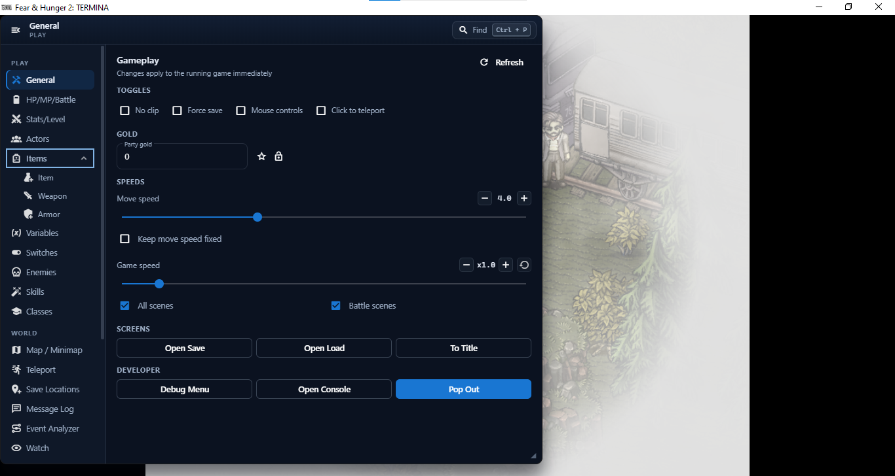
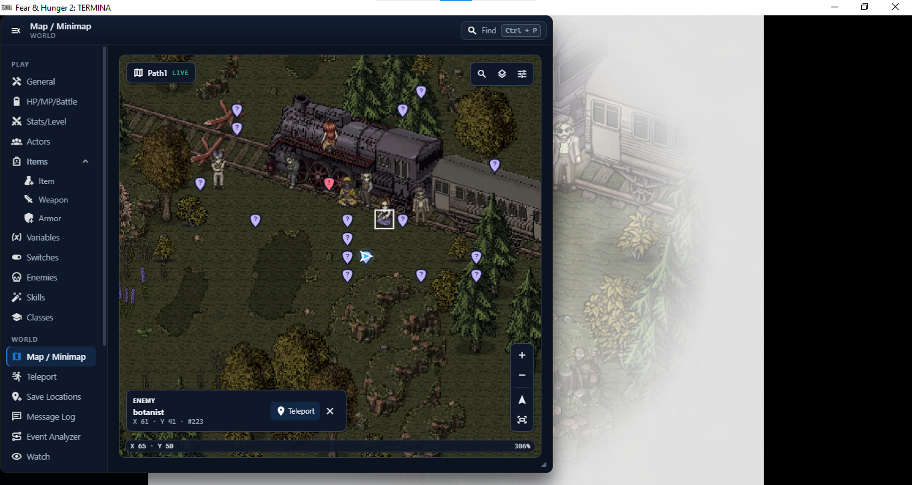
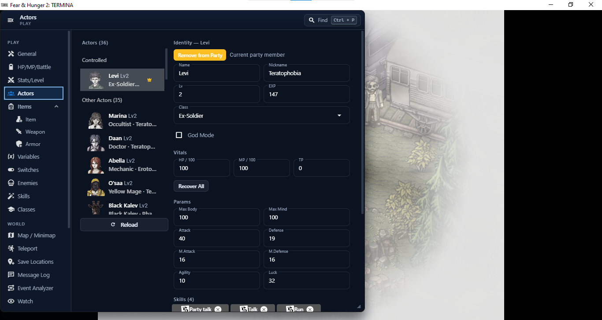
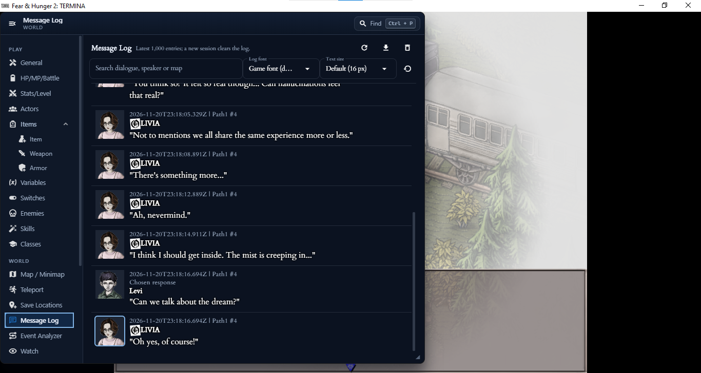
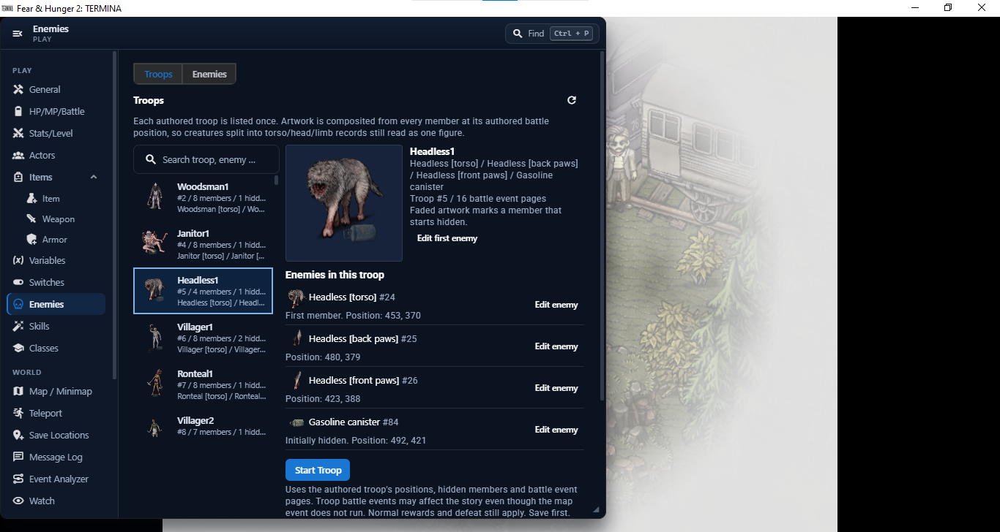
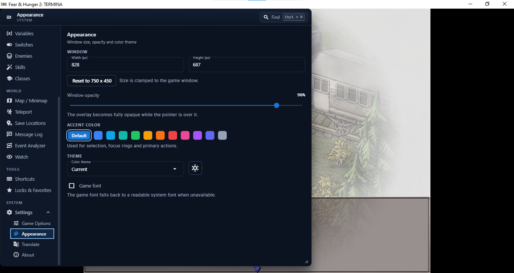
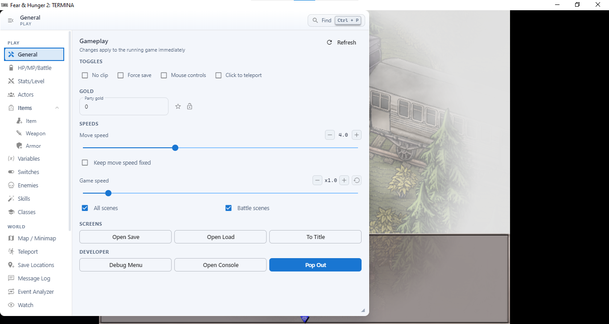

# RPG Maker MV/MZ Cheat UI + Translation

<p align="left">
  <a href="https://github.com/Eduwilll/RPG-Maker-MV-MZ-Cheat-UI-Plugin/releases">
    
  </a>
  <a href="https://github.com/Eduwilll/RPG-Maker-MV-MZ-Cheat-UI-Plugin/blob/main/LICENSE">
    
  </a>
  <a href="https://github.com/Eduwilll/RPG-Maker-MV-MZ-Cheat-UI-Plugin/stargazers">
    
  </a>
  <a href="https://github.com/Eduwilll/RPG-Maker-MV-MZ-Cheat-UI-Plugin/network/members">
    
  </a>
  <a href="https://github.com/Eduwilll/RPG-Maker-MV-MZ-Cheat-UI-Plugin/issues">
    
  </a>
  <a href="https://github.com/Eduwilll/RPG-Maker-MV-MZ-Cheat-UI-Plugin/commits/main">
    
  </a>
  <a href="https://github.com/Eduwilll/RPG-Maker-MV-MZ-Cheat-UI-Plugin/pulls">
    
  </a>
  <br/>
  <a href="https://deepwiki.com/Eduwilll/RPG-Maker-MV-MZ-Cheat-UI-Plugin">
    
  </a>
</p>

A compact, GUI-based cheat overlay for RPG Maker MV and MZ, with live database
editors, an interactive map, a searchable dialogue log and real-time machine
translation.

It works with standard MV/MZ games and with MZ games that boot through
[FOSSIL](https://github.com/FossilMZ/fossil-MV-MZ). Bundled test games exercise
more than 200 unique plugin names, including Yanfly, VisuStella, MOG, GALV, SRD,
HIME, Victor Engine, Olivia, CGMZ, Eli and PKD.

**[Documentation](https://eduwilll.github.io/RPG-Maker-MV-MZ-Cheat-UI-Plugin/)** ·
**[Install](https://eduwilll.github.io/RPG-Maker-MV-MZ-Cheat-UI-Plugin/guide/introduction/getting-started)** ·
**[Features](https://eduwilll.github.io/RPG-Maker-MV-MZ-Cheat-UI-Plugin/guide/features/features)** ·
**[Plugin Compatibility](https://eduwilll.github.io/RPG-Maker-MV-MZ-Cheat-UI-Plugin/guide/plugins/compatibility)** ·
**[Changelog](https://eduwilll.github.io/RPG-Maker-MV-MZ-Cheat-UI-Plugin/guide/meta/changelog)**



## ✨ Highlights

- **Compact overlay** — grouped sidebar sections, dense controls, Find (`Ctrl+P`),
  resizable window and a pop-out NW.js window for multi-monitor play.
- **Live game editors** — stats, HP/MP/TP, gold, items, weapons, armor, skills,
  actors, enemies, troops, classes, switches and variables update while you play.
- **Interactive map and minimap** — live tile artwork, pan/zoom/follow, event,
  enemy and treasure markers, layer visibility and explicit teleport actions.
- **Dialogue history** — Message Log captures the last 1,000 entries with speaker
  portraits, search, export and follow-new-dialogue behavior.
- **Translation at scale** — Lingva, local Lingva nodes, Ollama and
  OpenAI-compatible endpoints, with a local translation bank.
- **FOSSIL-aware installer** — patches the MZ HTML entry points, backs up the
  original game files and supports clean uninstall or rollback.

## 📸 UI Samples

<table>
  <tr>
    <td width="50%">
      
      <br><sub>Interactive map with live tiles, markers and teleport actions</sub>
    </td>
    <td width="50%">
      
      <br><sub>Actor editor with party roster, stats, skills and states</sub>
    </td>
  </tr>
  <tr>
    <td width="50%">
      
      <br><sub>Searchable dialogue history with speaker portraits</sub>
    </td>
    <td width="50%">
      
      <br><sub>Troop artwork, enemy records and battle actions</sub>
    </td>
  </tr>
  <tr>
    <td width="50%">
      
      <br><sub>Opacity, accents and current/legacy themes</sub>
    </td>
    <td width="50%">
      
      <br><sub>Dark and light modes keep the same compact layout</sub>
    </td>
  </tr>
</table>

## 🔥 Features

### Cheat and runtime

- Gold, party stats, HP/MP/TP, EXP, movement speed and game speed.
- Items, weapons, armor, skills, states, actors, enemies, troops and classes.
- No Clip, God Mode, Force Save, Disable Encounters and One-Hit Kill.
- Force victory, defeat, escape or abort; set party/enemy HP; fill TP; recover.
- Save/load shortcuts, return to title, NW.js console and the RPG Maker debug menu.

### World and navigation

- **Map / Minimap**: live tile artwork, pan, zoom, follow, fit, search and layer
  controls; separate radar/passability view when needed.
- **Teleport**: manual coordinates, map-center warp, click-to-teleport and saved
  locations with preset or custom flags.
- **Watcher**: live variables, switches and nearby event references, with an
  optional compact overlay.
- **Event Analyzer**: Common, Map and Battle event sequences with branch
  visualization and command tracing.

### Database editors

- Structured editors for enemies, troops, skills, classes, actors and items.
- Locks & Favorites for inventory, gold, variables, switches, timers and states.
- Detailed cards, searchable lists and windowed rendering for large databases.
- Edits apply to the running game and are never written back to `data/*.json`.

### Dialogue and translation

- **Message Log** (`Ctrl+H`): speaker names, portraits, chosen responses, map
  metadata, search, export, custom text size and game-font fallback.
- **Translation**: items, weapons, armors, actors, maps, system terms, variables,
  switches and dialogue.
- Translation Bank caches results; batch processing handles hundreds of strings;
  local Lingva, Ollama and OpenAI-compatible endpoints are supported.

### Interface

- Compact grouped navigation, Find a Feature, consistent panel headers and
  refresh actions.
- Current slate and legacy charcoal themes, dark/light mode, saved accent colors,
  window opacity and numeric overlay sizing.
- Pop-out cheat window, sidebar toggle, toast feedback and customizable shortcuts.

## 🛠️ Installation

### Automatic (recommended)

Download `RPGMakerCheatInstaller-v1.9.4-windows.zip` from the
[Releases page](https://github.com/Eduwilll/RPG-Maker-MV-MZ-Cheat-UI-Plugin/releases),
extract it, run `RPGMakerCheatInstaller.exe`, select your game folder and click
**Install**.

The installer detects MV or MZ, backs up the original files, copies the cheat and
patches the correct entry point. MZ games that use FOSSIL are handled
automatically.

### Manual install

Download the latest `-core.tar.gz` package for your engine from the
[Releases page](https://github.com/Eduwilll/RPG-Maker-MV-MZ-Cheat-UI-Plugin/releases)
and extract it. Copy the archive's `www/` contents into `{game}/www/` for MV, or
its `js/` and `cheat/` folders into the game root for MZ.

| Engine | Copy to | Back up / replace |
| --- | --- | --- |
| **RPG Maker MV** | `{game}/www/` | `www/js/main.js` |
| **RPG Maker MZ** | `{game}/` (game root) | `js/main.js` |

> [!CAUTION]
> Back up the original `main.js` first. The cheat replaces the game's entry point
> to inject the overlay.

MZ games that boot through FOSSIL also need one `<script>` tag in both
`index.html` and `FOSSILindex.html`. See
[Plugin Compatibility & Manual Install](https://eduwilll.github.io/RPG-Maker-MV-MZ-Cheat-UI-Plugin/guide/plugins/compatibility#fossil-games-mz)
for the exact placement and verification steps.

### Run

Launch the game and press **`Ctrl + C`**. The overlay starts semi-transparent in
the upper-right corner and becomes fully opaque while hovered.

### Plugin compatibility

| Category | Covered |
| --- | --- |
| Entry points | Standard MV/MZ and **FOSSIL** (installer-patched) |
| Tested suites | Yanfly, VisuStella, MOG, GALV, SRD, HIME, Victor Engine, Olivia, CGMZ, Eli, PKD |
| Systems | Terrax/MVNova/UMC lighting, FilterController, Mano_InputConfig, MUSH Audio, PluginCommonBase, OrangeGreenworks |
| Not supported | Obfuscated or engine-replacing scripts; plugin-drawn HUDs remain outside the cheat panels |

The full matrix, manual FOSSIL walkthrough and known limitations live in the
[plugin compatibility guide](https://eduwilll.github.io/RPG-Maker-MV-MZ-Cheat-UI-Plugin/guide/plugins/compatibility).

## 📦 Latest Release: v1.9.4

- **Bundled startup** — overlay and pop-out load single minified bundles
  (`setup.bundle.js`, `window-init.bundle.js`) instead of roughly 150 module
  requests; `pnpm run build:cheat` regenerates them from source.
- **Vue 2.7.16** — upgraded from Vue 2.6.14, the last 2.x release, with the
  Options API kept intact.
- **Offline-first assets** — Vuetify CSS, Material Design Icons (134 icons) and
  Roboto are bundled under `cheat/libs`; no Google Fonts or jsDelivr dependency.
- **Production libraries** — Vue and Vuetify ship minified, removing about 1.4 MB
  and development-mode warnings.
- **Event Analyzer fixes** — corrected four parsing bugs (infinite loop, 21% page
  truncation, 5% battle page loss, branch stall), with 34 new unit tests and a
  full test-game sweep.
- **Compact UI** — grouped navigation, denser controls, improved Find and compact
  Teleport coordinates.
- **Message Log** — follows new dialogue while preserving your reading position
  when you scroll back.
- **FOSSIL and plugin support** — installer patches MZ HTML entry points; dialogue
  and composite artwork handling improved for Yanfly/FOSSIL-style games.

See the [full changelog](https://eduwilll.github.io/RPG-Maker-MV-MZ-Cheat-UI-Plugin/guide/meta/changelog)
for every fix and previous release.

## 🌍 Translation Setup

1. Open the menu (**`Ctrl + C`**) and choose **Settings > Translate**.
2. Toggle **Enable** on.
3. Select an endpoint (for example **Lingva JA → EN**).
4. Choose targets (variables, items, maps, dialogue and more) and click
   **Start Translation**.

### Self-hosting Lingva (Docker)

For maximum speed and privacy, run Lingva locally.

```bash
# Single instance on port 3000
docker run -d -p 3000:3000 thedaviddelta/lingva-translate
```

Then select **Local Lingva Docker (Port 3000)** in the endpoint list.

For the 3-node cluster used in the benchmark below:

```bash
docker-compose up -d
```

This starts instances on ports 3000, 3001 and 3002; select **Local Lingva Docker
(Ports 3000, 3001, 3002 Balanced)**.

### Benchmarks

Real run translating a full game (13,338 unique strings), Japanese → English:

| Endpoint | Time | Throughput | Batches | p50 latency | Success |
| --- | --- | --- | --- | --- | --- |
| **3-Node Docker Balanced** | **1m 23s** | 161 str/s | 467 | 4,055 ms | 99.3% |
| **Single Docker** | **3m 40s** | 61 str/s | 473 | 12,517 ms | 99.0% |
| **Public API (lingva.ml)** | **48m 33s** | 4.6 str/s | 784 | 3,684 ms | 99.9% |

The 3-node setup is about **35× faster** than the public API and avoids
Cloudflare rate limiting. A metrics report is printed to the developer console
after each run.

## 🧑‍💻 Development and Testing

### Browser preview

Develop the Vue/Vuetify UI without launching a game. The preview uses the same
vendored, offline-safe assets as the plugin.

```powershell
py -3 start-preview.py
# or
py -3 start-preview.py --port 8081 --no-browser
```

Open `http://localhost:8080/preview/index.html`. Saving JS, CSS, HTML or JSON
reloads the preview. The toolbar selects any current panel, MV/MZ mode and
exploration/battle/title scenarios; the current panel survives reloads.

```powershell
pnpm run test:browser:install
pnpm run test:preview
```

### Dev-sync

Link the repository to a test game so saved changes appear on `F5`.

```powershell
.venv\Scripts\python.exe deploy\dev.py --game-path "C:/MyTestGame"

# Local test folders with interactive selection
.venv\Scripts\python.exe deploy\dev.py --mv
.venv\Scripts\python.exe deploy\dev.py --mz

# Optional version label
.venv\Scripts\python.exe deploy\dev.py --mz --version v1.2.3-alpha
```

### Build releases

```powershell
pnpm run build:cheat
pnpm run build:compact
pnpm run check:dependency-sources
py -3 deploy\main.py --version 1.9.4
```

This creates four archives in `output`: MV/MZ `-core.tar.gz` packages are
**Offline**; MV/MZ `-online-core.tar.gz` packages are **Online (cached)**.
Both use `cheat-bundle.js` and `cheat-bundle.css`, with small startup, metadata
and license files instead of shipping the editable source tree.

Offline includes all dependencies and is portable. Online downloads verified,
release-pinned dependencies once, then works offline. Its Windows cache is
`%LOCALAPPDATA%\RPGMakerCheatUI\dependencies`; it is shared across games and
kept on uninstall. Copying Online to another computer may require a download.

Then build the Windows installer:

```powershell
py -3 tools\installer\build_windows.py --version 1.9.4
```

This creates `output\RPGMakerCheatInstaller-v1.9.4-windows.zip`.
The ZIP includes all four archives. Select Offline or Online in the installer;
the complete installer download is not smaller just because Online is available.

To install a specific Online archive from the command line:

```powershell
py -3 tools\installer\cli.py install --game-path "C:\Games\MyGame" --archive "output\rpg-mv-cheat-1.9.4-online-core.tar.gz" --edition online
```

### Verification

```powershell
pnpm run check:repo
pnpm run test:compact
```

That runs unit tests, type checking, the MV compatibility scan and the docs
build. Browser smoke tests (`pnpm run test:browser`) cover rendered panels, the
pop-out bootstrap and the committed development bundles. `test:compact` checks
both compact editions with external network blocked (build them first).
Manual MV/MZ testing is still the
final check for third-party battle systems and game-specific behavior.

### Formatting

Prettier and Husky keep commits formatted. `pnpm run format` runs manually;
`git commit` triggers `lint-staged` automatically.

For architecture details, see the
[Architecture Overview](docs/guide/technical/architecture.md).

## 📜 Credits

- **Original plugin**: [paramonos](https://github.com/paramonos/RPG-Maker-MV-MZ-Cheat-UI-Plugin)
- **Translation idea**: [sieucapoccho3717](https://github.com/sieucapoccho3717/RPG-Maker-MV-MZ-Cheat-UI-Plugin)
- **Map Event Panel**: [Justype](https://github.com/Justype/RPG-Maker-MV-MZ-Cheat-UI-Plugin)
- **Maintained and expanded by**: [Eduwilll](https://github.com/Eduwilll/RPG-Maker-MV-MZ-Cheat-UI-Plugin)

## 💡 Issues and Feature Requests

- **Bug?** Open a [bug report](https://github.com/Eduwilll/RPG-Maker-MV-MZ-Cheat-UI-Plugin/issues/new?template=bug_report.yml) with the game, engine, plugin list and logs.
- **Idea?** Open a [feature request](https://github.com/Eduwilll/RPG-Maker-MV-MZ-Cheat-UI-Plugin/issues/new?template=feature_request.yml) describing the problem and what it should do.
