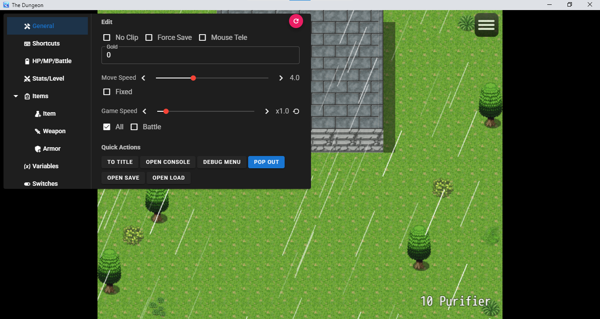
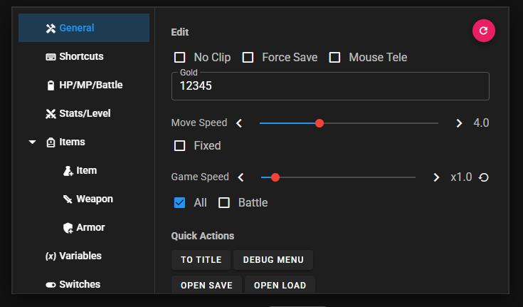
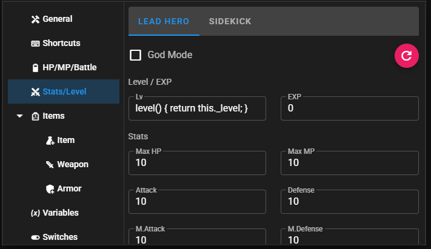
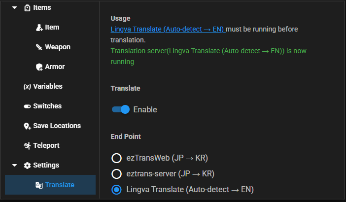

# RPG Maker MV/MZ Cheat UI + 번역 (Real-time Machine Translation)

RPG Maker MV/MZ 게임을 위한 강력한 GUI 기반 치트 툴이며, **실시간 기계 번역** 기능을 지원합니다.

### 최신 릴리스: v1.11.0
- **연결된 맵 도구**: 맵, 액터 및 이벤트 분석기 사이를 이동하고 태그별 저장 위치 핀을 확인할 수 있습니다.
- **목적지 미리보기**: 텔레포트와 저장 위치에서 맵 이동, 확대/축소 및 타일 선택을 지원하며, 이동 버튼을 눌러야 실제로 이동합니다.
- **간결한 편집 패널**: 액터, 적, 스킬, 클래스 편집을 검색 목록과 주제별 섹션으로 정리했습니다. 스킬은 목록에서 바로 습득하거나 삭제할 수 있습니다.
- **스킬 관련 스위치 검토**: 이벤트 근거와 이름 일치를 확인하고 개별 변경을 승인할 수 있습니다. 스킬 습득만으로 전역 스위치를 켜지 않으며, 플러그인 스크립트의 모든 조건을 분석할 수 있는 것은 아닙니다.
- **기본 창 크기**: 오버레이와 별도 창의 기본 크기는 880 x 660이며 기존에 저장한 크기는 유지합니다.

#### Offline / Online 에디션
- **설치 에디션 선택**: Offline은 모든 파일을 포함하며, Online (cached)은 검증된 의존성을 한 번 다운로드한 뒤 공유 로컬 캐시로 오프라인 실행됩니다.
- **컴팩트 배포**: `cheat-bundle.js`, `cheat-bundle.css`와 작은 시작 파일, 메타데이터 및 라이선스 파일을 설치합니다.
- **안전한 설치 준비**: Online 캐시를 먼저 검증하므로 다운로드 실패 시 기존 플러그인과 설정이 유지됩니다. 백업, 복원 및 제거 기능도 유지됩니다.
- **저장 데이터 보호**: UI 다운로드를 기다리지 않고 저장 훅을 설치하며, MZ에서 저장 관리자가 늦게 생성되는 경우도 처리합니다.
- **사이드바 스크롤 수정**: 늦게 로드된 치트 UI의 마우스 휠 입력이 게임에 차단되지 않도록 수정했습니다.

#### 기존 주요 기능
- **번들 시작**: 오버레이와 팝아웃 창이 이제 단일 번들(`setup.bundle.js`, `window-init.bundle.js`)을 로드합니다(약 150개 모듈 요청 → 1개); `pnpm run build:cheat`로 소스에서 재생성
- **Vue 2.7.16**: 벤더 런타임을 Vue 2.6.14에서 2.7.16(마지막 2.x)으로 업그레이드, Options API 드롭인 호환
- **오프라인 우선**: Vuetify CSS, Material Design Icons(134개, ~16 KB), Roboto 폰트를 `cheat/libs`에 로컬 번들 — Google Fonts/jsDelivr 의존성 없음
- **프로덕션 빌드**: Vue/Vuetify가 축소된 프로덕션 빌드로 제공, ~1.4 MB 및 개발 모드 경고 제거
- **이벤트 분석기 수정**: 파싱 버그 4개 수정(무한 루프, 21% 페이지 잘림, 5% 배틀 페이지 손실, 분기 정지); 34개 새 단위 테스트 + 테스트 게임 전체 스윕(67,434 페이지)
- **테스트 가능 아키텍처**: 부트스트랩 심 추출(`RpgMakerGlobals.js`, `CheatApp.js`, `CheatVersion.js`); 기능 런타임을 `this.cheatRuntime`으로 주입(`window.__cheatFeatures` 대신); 패널 상태 헬퍼 단위 테스트 가능
- **패널 스냅샷 최적화**: `applyPanelSnapshot()` 헬퍼로 상태를 한 번에 병합, 변경 없는 값 건너뜀; General, Health, Stats, Inventory, Actor, Translation 패널에 적용
- **버전 비교 수정**: 숫자 세그먼트 비교로 `v` 접두사 무시, 거짓 업데이트 경고 방지
- **스테일 번들 가드**: 매니페스트가 번들/소스 해시 기록; 런타임 변경 후 미빌드시 단위 테스트 실패
- **Locks & Favorites 아이콘**: 빈 사이드바 아이콘 수정(`mdi-lock-star` → 제공된 아이콘)
- **맵 드롭다운 Z-인덱스**: 드롭다운이 치트 오버레이 위에 유지됨
- **아키텍처 회귀 수정**: 최근 리팩토링의 회귀 수정
- **메시지 로그**: 새로운 대화가 자동으로 따라가며, 위로 스크롤했을 때 읽던 위치가 유지됩니다.
- **텔레포트 수정**: TeleportPanel이 CheatModal 셸에 올바르게 등록되어 텔레포트 기능이 복구되었습니다.
- **MV 호환성**: RPG Maker MV의 설정과 로그가 `www/` 폴더 안에 올바르게 유지됩니다.
- **내부 리팩토링**: GeneralCheat가 이동(노클립), 갓 모드, 영속성 모듈로 분리되고, CheatModal 셸이 NavigationModule, PanelRegistryModule, ProfileSyncModule로 심화되었습니다.
- **프로필 및 사이드바**: 반응형 프로필 상태, 널 안전성 수정, ProfileSyncModule 초기화 수정.
- **데이터베이스 패널**: 전체 트룹 아트워크 합성, 대용량 데이터셋을 위한 윈도우 렌더링, 아트워크 및 테마 수정.
- **성능**: 정적 패널 설정 고정, 데드 코드 제거.
- **인터랙티브 맵 / 미니맵**: 드래그 이동, 확대/축소, 플레이어 추적, 이벤트 검색과 맵 내부 설정을 제공합니다. 위치를 선택한 뒤 Teleport 버튼으로 이동합니다.
- **실시간 표시**: 방향이 표시되는 플레이어 화살표, 게임 캐릭터 이미지와 종류별 마커를 프레임 단위로 갱신합니다.
- **간결한 UI와 테마**: 정리된 탐색 메뉴, 작은 X/Y 입력란, Current / Legacy 색상 테마를 지원합니다.
- **설치 프로그램과 저장 편집기**: 간단한 설치 화면, 명확한 완료 안내, 유지 관리 기능과 잘리지 않는 스크롤 편집 필드를 제공합니다.
- **설치 프로그램 정보**: GitHub 및 문서 링크, 버그 신고, 제작진 크레딧과 MIT 라이선스를 설치 프로그램 안에서 확인할 수 있습니다.
- **설치 프로그램 시작 오류 수정**: Python 3.14의 Tcl/Tk 9 데이터 압축 파일을 찾아 단일 실행 파일에 포함하여, 시작할 때 `_tcl_data` 오류로 종료되던 `RPGMakerCheatInstaller.exe` 문제를 해결했습니다.
- **일관된 패널**: 공통 패널 헤더와 새로 고침 버튼을 사용하며, Current / Legacy 테마에 맞춰 컨트롤 색상이 바뀝니다.
- **설치 프로그램 안정성**: Tcl/Tk 데이터를 포함해 별도 Python/Tk 설치 없이 패키지 설치 프로그램이 실행됩니다.

---

## 📸 UI 샘플
<p float="left">
  
  
  
  
</p>

---

## 🔥 주요 기능
- **새로운 유틸리티**: 
  - **Force Save**: 게임 내 저장 제한을 무시하고 강제로 저장 기능을 활성화합니다.
  - **디버그 메뉴**: NW.js 콘솔 및 RPG Maker 디버그(F9) 메뉴에 즉시 접근 가능.
  - **전술 맵 패널**: 플레이어, 이벤트, 적군, 보물 상자를 실시간으로 추적하는 인터랙티브 맵 오버레이.
  - **Enable Mouse Controls**: RPG Maker 터치 입력을 비활성화한 게임에서 마우스/터치 메뉴와 클릭 이동을 복원합니다.
  - **마우스 텔레포트**: 맵 클릭 또는 `Alt + M` 키로 즉시 이동할 수 있는 기능.
  - **Watcher Panel**: 저장한 변수와 스위치를 추적하고 선택적 오버레이를 표시합니다. 가까운 맵 이벤트 참조는 이벤트 분석기에서 확인합니다.
  - **Installer Save Editor**: 백업을 만든 뒤 MV/MZ 저장 파일을 구조화된 필드 또는 Raw JSON으로 편집합니다.
  - **토스트 알림**: 노클립, 강제 저장, 인카운트 상태 변경 시 화면 레이어 알림.
  - **팝업 윈도우**: 치트 UI를 별도의 독립된 창에서 실행하여 멀티태스킹 최적화.
  - **원 히트 킬(One-Hit Kill)**: 배틀 패널에서 모든 플레이어 공격이 적을 즉시 격파하도록 하는 토글.
  - **사이드바 가시성 토글**: CheatModal 사이드바를 표시/숨겨 게임 화면 공간을 확보하는 토글.
  - **맵 중심 선택**: 텔레포트 미리보기에서 중심 좌표를 선택한 뒤 이동 버튼으로 워프합니다.
  - **변수 값 유형 필터**: 변수 패널에서 양수, 음수, 또는 0/미설정 값만 표시하도록 필터링.
  - **이름 없는 아이템 기본 숨김**: 아이템 패널이 이름 없는 항목을 기본으로 숨기고 탭 전환 시에도 설정을 유지.
  - **외관 패널**: 창 투명도, 다크 모드, 강조 색상 사용자화.
  - **이벤트 분석 패널**: 커먼/맵/배틀 이벤트 시퀀스 검사 및 분기 시각화.
  - **저장 위치 플래그**: 저장 위치에 프리셋 또는 커스텀 플래그 태그.
  - **액터 패널**: 전체 액터 목록(조작 중 / 파티 / 기타 액터)과 이름, 레벨, HP/MP/TP, 파라미터, 스킬, 상태 편집.
  - **이전 외관 복원**: 다크 테마 기본값, 미호버 시 30% 투명도, 테마 스크롤바.
  - **미니맵**: 실제 타일 그래픽 오버레이, 위치/줌 지정, 이벤트 마커 표시 (`Alt+N` 토글).
- **스마트 번역**: 실시간으로 변수, 스위치, 맵 이름, 아이템 설명 번역.
  - **Lingva Translate** 지원 (개인 정보 보호 및 무료 구글 번역 대안).
  - **Translation Bank**: 번역된 내용을 캐시하여 다음 로드 시 즉시 반영.
  - **일괄 처리 (Batch Processing)**: 수백 개의 항목을 몇 초 만에 번역.
- **단축키 커스텀**: 원하는 모든 키에 치트 기능 할당 가능.

---

## 🛠️ 빠른 설치 방법 (MV/MZ)

1. **다운로드**: [Releases](https://github.com/Eduwilll/RPG-Maker-MV-MZ-Cheat-UI-Plugin/releases)에서 최신 zip 파일을 받으세요.
2. **파일 복사**: 압축을 풀고 `js` 및 `cheat` 폴더를 게임 폴더에 복사합니다:
   - **MV**: `{game_dir}/www/` 에 복사.
   - **MZ**: `{game_dir}/` 에 복사.
   > ⚠️ **주의**: `main.js` 파일이 덮어씌워지므로 반드시 미리 백업하세요!
3. **실행**: 게임 실행 후 **`Ctrl + C`** 키를 눌러 치트 메뉴를 엽니다.

---

## 🐳 Lingva 셀프 호스팅 (Docker)
더 빠른 번역 속도와 완벽한 개인 정보 보호를 위해 자신의 PC에서 직접 Lingva를 실행할 수 있습니다.

### 옵션 1: 단일 인스턴스 (Fast)
```bash
docker run -d -p 3000:3000 thedaviddelta/lingva-translate
```
- 플러그인 설정에서 **"Local Lingva Docker (Port 3000)"**를 선택하세요.

### 옵션 2: 3-노드 클러스터 (Balanced/Extreme Speed)
이 레포지토리의 `docker-compose.yml`을 사용하여 3000, 3001, 3002 포트에서 실행되는 3중화 클러스터를 구성할 수 있습니다.
```bash
docker-compose up -d
```
- 플러그인 설정에서 **"Local Lingva Docker (Ports 3000, 3001, 3002 Balanced)"**를 선택하세요.

---

## 🌍 번역 세팅 방법
1. 메뉴 열기 (**`Ctrl + C`**) -> **Translation** 탭으로 이동.
2. **Enable** 스위치를 ON으로 설정.
3. **End Point** 선택 (예: **Lingva JA → EN**).
4. **Targets** 에서 번역할 항목(Variables, Items 등)을 체크하고 **"Start Translation"**을 누릅니다.

---

## 🛠️ 개발 및 UI 미리보기 (Development)

우리는 UI 개발 및 게임 통합 속도를 높이기 위한 전문적인 도구를 제공합니다.

### 1. Web-UI 미리보기 (브라우저 개발)
게임 재시작 없이 브라우저에서 직접 Vue/Vuetify UI를 실시간으로 개발할 수 있습니다.
- **참고**: 미리보기용 종속성 설치가 필요하지 않습니다 (`cheat/libs/`의 로컬 라이브러리 사용).

```powershell
# Python 가상 환경에서 미리보기 실행
.venv\Scripts\python.exe start-preview.py
```
- 브라우저에서 `http://localhost:8080/preview/index.html`을 엽니다.

### 2. Dev-Sync (자동 주입 및 심볼릭 링크)
개발 폴더를 테스트 게임에 연결합니다. IDE에서 저장한 변경 사항은 게임에서 즉시 확인 가능합니다 (`F5` 키).
```powershell
# 임의의 게임에 설정
.venv\Scripts\python.exe deploy\dev.py --game-path "C:/MyTestGame"

# 로컬 테스트 폴더 빠른 설정 (인터랙티브 선택 포함)
.venv\Scripts\python.exe deploy\dev.py --mv
.venv\Scripts\python.exe deploy\dev.py --mz

# 선택 사항: cheat-version-description.json 에 커스텀 버전 명시
.venv\Scripts\python.exe deploy\dev.py --mz --version v1.2.3-alpha
```

### 3. 자동 포맷팅 (Prettier & Husky)
일관된 코드 스타일 유지를 위해 **Prettier**를 사용하며, **Husky**를 통해 모든 커밋 전에 자동으로 포맷이 적용됩니다.
- **수동 포맷**: `pnpm run format`
- **Pre-commit Hook**: `git commit` 시 `lint-staged`가 자동으로 변경 사항을 정리합니다.

### 4. 기술 아키텍처
개발자 및 기여자는 핵심 엔진, UI 후킹 및 데이터 관리 기초에 대한 자세한 내용을 **[Architecture Overview](docs/guide/technical/architecture.md)**에서 확인하세요.

---

## 📜 Credits
- **Original Plugin**: [paramonos](https://github.com/paramonos/RPG-Maker-MV-MZ-Cheat-UI-Plugin)
- **Translation Idea**: [sieucapoccho3717](https://github.com/sieucapoccho3717/RPG-Maker-MV-MZ-Cheat-UI-Plugin)
- **Map Event Panel**: [Justype](https://github.com/Justype/RPG-Maker-MV-MZ-Cheat-UI-Plugin)
- **Maintained & Enhanced by**: [Eduwilll](https://github.com/Eduwilll/RPG-Maker-MV-MZ-Cheat-UI-Plugin)

Latest Release: v1.10.0

### v1.10.0 주요 변경 사항
- 설치 프로그램에서 Offline 또는 Online (cached)을 선택할 수 있습니다. MV/MZ용 네 가지 패키지가 제공됩니다.
- Online 의존성은 고정된 소스와 SHA-256 검증을 사용하며, 공유 캐시는 게임 제거 후에도 다른 게임을 위해 유지됩니다.
- 다운로드 중 저장 데이터 보호, 이전 MV 런타임의 HTTPS 호환성, 팝아웃 시작 및 사이드바 휠 스크롤을 개선했습니다.

### v1.9.4 주요 변경 사항
- **번들 시작**: 오버레이와 팝아웃 창이 이제 단일 번들(`setup.bundle.js`, `window-init.bundle.js`)을 로드합니다(약 150개 모듈 요청 → 1개); `pnpm run build:cheat`로 소스에서 재생성
- **Vue 2.7.16**: 벤더 런타임을 Vue 2.6.14에서 2.7.16(마지막 2.x)으로 업그레이드, Options API 드롭인 호환
- **오프라인 우선**: Vuetify CSS, Material Design Icons(134개, ~16 KB), Roboto 폰트를 `cheat/libs`에 로컬 번들 — Google Fonts/jsDelivr 의존성 없음
- **프로덕션 빌드**: Vue/Vuetify가 축소된 프로덕션 빌드로 제공, ~1.4 MB 및 개발 모드 경고 제거
- **이벤트 분석기 수정**: 파싱 버그 4개 수정(무한 루프, 21% 페이지 잘림, 5% 배틀 페이지 손실, 분기 정지); 34개 새 단위 테스트 + 테스트 게임 전체 스윕(67,434 페이지)
- **테스트 가능 아키텍처**: 부트스트랩 심 추출(`RpgMakerGlobals.js`, `CheatApp.js`, `CheatVersion.js`); 기능 런타임을 `this.cheatRuntime`으로 주입(`window.__cheatFeatures` 대신); 패널 상태 헬퍼 단위 테스트 가능
- **패널 스냅샷 최적화**: `applyPanelSnapshot()` 헬퍼로 상태를 한 번에 병합, 변경 없는 값 건너뜀; General, Health, Stats, Inventory, Actor, Translation 패널에 적용
- **버전 비교 수정**: 숫자 세그먼트 비교로 `v` 접두사 무시, 거짓 업데이트 경고 방지
- **스테일 번들 가드**: 매니페스트가 번들/소스 해시 기록; 런타임 변경 후 미빌드시 단위 테스트 실패
- **Locks & Favorites 아이콘**: 빈 사이드바 아이콘 수정(`mdi-lock-star` → 제공된 아이콘)
- **맵 드롭다운 Z-인덱스**: 드롭다운이 치트 오버레이 위에 유지됨
- **아키텍처 회귀 수정**: 최근 리팩토링의 회귀 수정

---

## 💡 문제 신고 및 기능 요청
- **버그?** [버그 리포트](https://github.com/Eduwilll/RPG-Maker-MV-MZ-Cheat-UI-Plugin/issues/new?template=bug_report.yml)를 열어주세요 — 게임, 엔진, 버전, 로그를 묻습니다.
- **아이디어?** [기능 요청](https://github.com/Eduwilll/RPG-Maker-MV-MZ-Cheat-UI-Plugin/issues/new?template=feature_request.yml)을 열어주세요.
