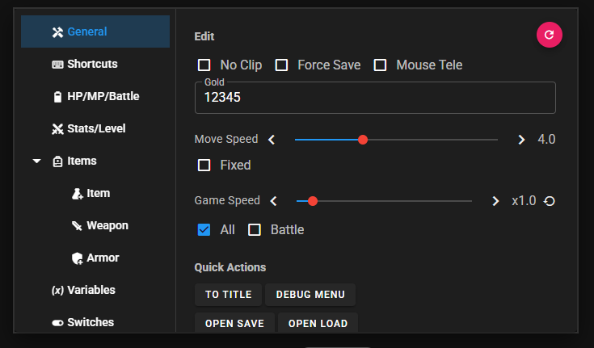
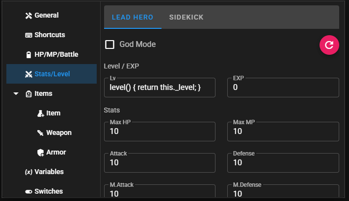
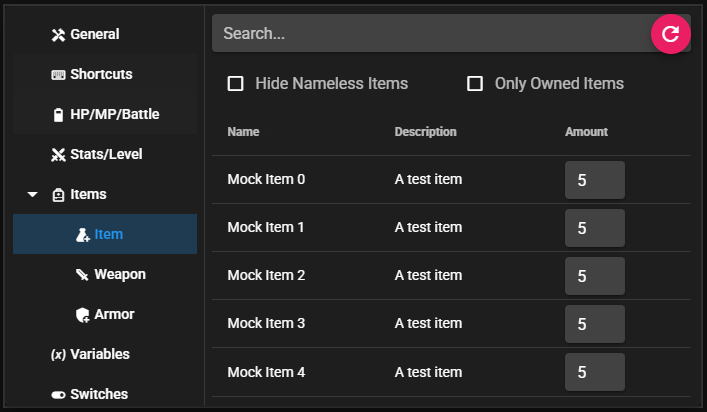
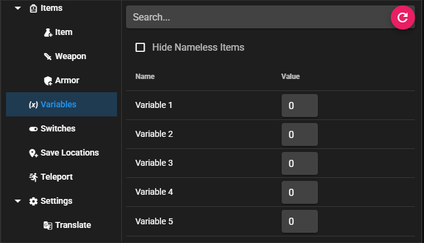
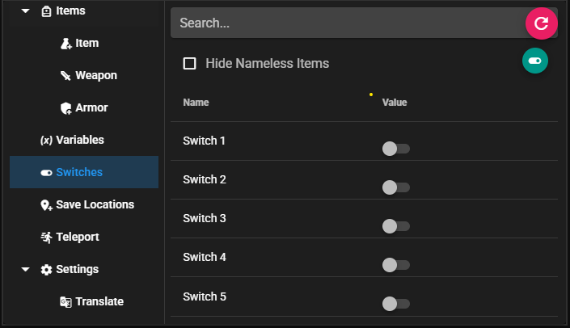
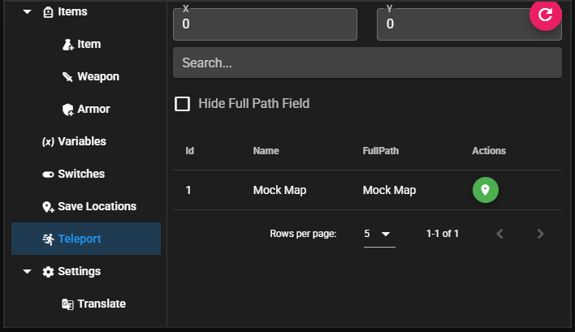
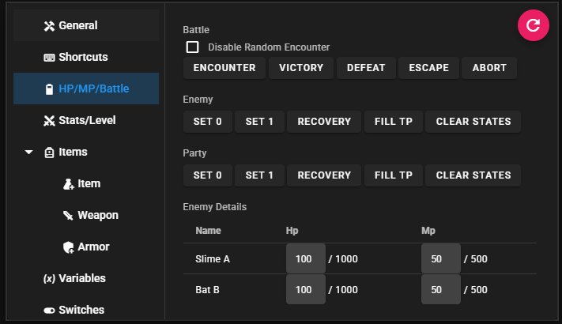
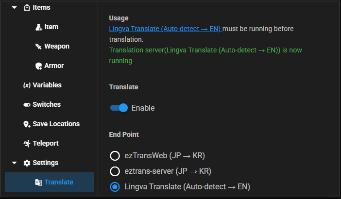

# Features

This page is the quick reference for the main panels and tools exposed by the cheat UI.

## Open the cheat UI

Press <kbd>Ctrl</kbd> + <kbd>C</kbd> to toggle the main overlay. By default it appears in the upper-right corner of the game window and stays semi-transparent until you hover over it.

You can rebind that shortcut from the [Shortcuts](/guide/features/shortcuts) page.

## Find a feature

Press **Ctrl+P**, or choose **Find a Feature** in the sidebar. Search panels,
settings, and your configured shortcuts. Use Up/Down and Enter to navigate, or
click a result. Setting results scroll to and highlight the relevant control.

## Enemy, skill, and class editors

The **Enemies**, **Skills**, and **Classes** panels expose structured editors for
enemy parameters/actions/rewards, skill costs/success/damage/effects, and class
parameter curves/EXP/level-up skills/traits. Edit a draft, choose **Apply**, then
save the game to keep the changes. **Discard Draft** reloads current values;
**Reset to Original** removes that record's override, taking effect permanently
for the slot when you save again.

Changes are isolated to each save. Original `data/*.json` files are never written.
Older saves without overrides work normally. Uninstalling the cheat leaves saves
loadable, but overridden database behavior requires the cheat to be installed.
Class level-up rule edits do not retroactively learn or forget actor skills.

Damage formulas are RPG Maker JavaScript. They are stored as text, not evaluated
as a preview; invalid formulas can fail when the game uses the skill.

The enemy panel also starts existing troops or temporary custom rosters and can
summon reinforcements during safe battle phases. Starting an encounter is blocked
while another battle, map event, message, or transfer is active. Unsupported battle
renderers show a reason instead of forcing a mutation. Third-party battle systems
still require testing in the actual game.

## Detailed cards

Hover, focus, or click database names in the supported item, actor, and editor
views. Bounded cards show applicable stats, effects, traits, costs/rewards, and
prices. Descriptions and formulas are displayed as text, never executable HTML.

## Locks and favorites

Use the star and lock buttons beside inventory quantities, gold, variables,
switches, and actor states. Favorites stay above normal rows while respecting
search/filter choices and the selected ordering within each group.

**Locks & Favorites** reviews all targets and includes timer and status-presence
controls. A timer lock freezes both its exact remaining frames and running/stopped
state. Status locks can keep a state present or absent; locking death requires a
warning confirmation. Inventory locks affect unequipped inventory, not equipped copies.

Locks/favorites are game-local, persist across save slots, and never enter portable
settings profiles. Missing targets are disabled with diagnostics and remain removable.

## Message log

Press **Ctrl+H** to read and search the latest 1,000 captured dialogue entries,
including speaker/map metadata where available. Export plain text or clear the
history without dismissing the game's current message. New game/load clears the
history. Text shown before the cheat initialized and arbitrary plugin-drawn text
cannot be recovered.

## Game options

**Settings > Game Options** includes Always Dash, Remember Commands, and the four
volume controls. Discoverable game-specific options appear first. Complex or
disabled plugin options remain read-only; if discovery fails, standard options
still work. Only values changed here are included in the options portion of a
[portable settings backup](/guide/features/sharing-settings).

## General tab

Utility controls that affect the running game immediately.

| Feature | What it does |
| --- | --- |
| Force Save | Bypasses game-level save restrictions so you can save where the game normally blocks it |
| Mouse Teleport | Lets you jump by clicking the map when the toggle is enabled |
| Debug Console | Opens NW.js developer tools for inspection and debugging |
| Debug Menu | Opens the built-in RPG Maker debug menu |
| Pop Out Window | Moves the cheat UI into a separate standalone window in NW.js |

## Stats tab

Change live party values without opening built-in game menus.

| Field | What it affects |
| --- | --- |
| HP / MP | Current and max values for party members |
| Gold | Party gold amount |
| Movement speed | Walk and run speed behavior |
| Level | Actor level adjustments |

## Items tab

- Search for items by name.
- Add or remove items, weapons, and armors.
- Set quantities directly instead of editing through event commands.

## Variables tab

Read and update game variables by name or ID. This is useful for event flags, progression values, and debugging route-specific behavior.

## Switches tab

Toggle boolean game switches in real time. Search helps when games have hundreds of named switches.

## Map and teleport tools

| Feature | What it does |
| --- | --- |
| Save location | Stores current map ID and coordinates |
| Recall location | Returns you to a saved point |
| Manual teleport | Moves you to entered map and coordinate values |
| No Clip | Lets the player move through blocked terrain |

### Map / Minimap

The **Map / Minimap** sidebar page combines the full map with expandable
**Floating minimap settings**. Search for Floating Minimap to jump to those
settings. The older `minimap-panel` route still works for existing links.

The full map defaults to **Realistic (live tiles)**, sharing the minimap's rendered
tile artwork. It preserves ground layers, autotile shapes, shadows and table edges,
with live player/event markers and character sprites. Choose **Radar (passability)** for the original
walkable/blocked grid. The display choice persists when reopening the panel.

Both modes support the 25x25/full-map view, hover details and click-to-teleport,
including in the separate cheat window. **Refresh artwork** rebuilds the cached
map if a game plugin changes tiles in place. Missing/loading tileset images fall
back to radar with a status message. Plugin-specific lighting, weather, pictures
and screen effects are not reproduced in the full-map artwork.

### Map Layers

Expand **Map layers** on the combined map page to customize both views. These
preferences are saved for the game and shared with the separate cheat window.

- **Tile shadows / dimming** removes engine tile shadows from the cheat artwork.
- **Roofs / upper tiles** hides tiles marked as upper layers, independently of shadows.
- **NPCs**, **Enemies**, **Items / treasure**, **Other events** and **Player marker**
  control marker visibility. **Event names / IDs** enables labels.
- **Show actual NPC / event sprites** uses the game's loaded character images and
  current frame, facing and opacity. It is enabled by default. Turning it off
  restores lightweight colored markers. Missing images fall back to markers.
- **Map background**, **Grid** and **Marker size** customize readability.
- **Reset map layers** restores the defaults without resetting other cheat settings.

For the floating minimap, **Show characters and event markers** must also be enabled.
It defaults on for new settings; a previously saved off preference is respected. Marker
categories use active event pages and bounded common-event references. Walking
NPCs are not assumed to be enemies. Rewards behind conditions are only hints;
custom script-only battles/pickups may remain unclassified. Changing pages or
erasing events updates the markers. No event commands are executed to classify them.

These controls change only cheat rendering. Shadows already painted into image
files, unmarked roof tiles, and custom plugin lighting/fog cannot be selectively
removed. The game's actual map, passability, lighting and events are untouched.
Custom child-sprite plugin effects and exact roof occlusion are not reproduced.
Loaded engine bitmaps, including composite/encrypted character art, stay in the
game realm; fallback sheets load privately and never paint into old map canvases.

### Dialogue Names And Portraits

Message Log (`Ctrl+H`) resolves actor/party names, variables, currency and common
MV/MZ/YEP presentation codes into readable text. Speaker labels and portraits are
snapshotted when the message enters the queue, so later changes do not rewrite
history. The normal message renderer can update a captured batch with localized
text without running plugin escape evaluators a second time. It recognizes explicit speaker names/name boxes and unambiguous actor
portraits; a character mentioned in narration is not automatically its speaker.

Termina's icon-letter headings resolve unique actor names such as Marina; unknown
speakers retain their original icon and name suffix. Dialogue uses the game's font
by default, even when the rest of the cheat uses its default font.

Only confirmed player responses enter the log, labeled **Chosen response** with
the current party leader's name and portrait. Unchosen options and cancelled
prompts are not recorded. Without a known leader, the label is **Player**, not the
previous NPC. Choice menus can also represent actions rather than spoken lines.

Decorative name initials retain the game's original icon artwork while full names
remain searchable and available to assistive technology. When the normal message
window renders, the log snapshots its base font family, size, weight, italics,
text color and outline. The log displays dialogue at **Default (16 px)** rather
than copying the larger game-window size. Select **Custom** text size for a
12-40px value. **Log font** switches between the default **Game font** and
**Plugin font (fallback)** if a game's font does not render correctly. This fallback
also overrides the overlay's global game-font preference within the log.

Preferences apply to existing and new displayed entries, persist per game, and
are shared with the separate window. **Reset text display** restores game font and
16px text without clearing dialogue or changing the game. Captured metadata is not
rewritten. Arbitrary inline plugin layout/effects are not replayed.

Portraits support encrypted assets and KC composite face sheets. For NPCs without
an actor face, an unambiguous visible picture with an authored portrait path
matching the speaker (such as Elderfield's `Portraits/Sam`) can be used. An unavailable
portrait displays a placeholder. Unknown custom escape codes remain visible rather
than executing plugin scripts. This affects captured history, not the game's
original dialogue windows, and applies to newly captured messages in the session.

## Battle tools

### Enemy Browser And Fight Actions

Enemies opens in **Encounters / Roots** mode. It groups heads, limbs and other
members under their authored database troop, including initially hidden members.
Troop variants stay separate. The representative artwork/name is a display aid,
not an invented parent pointer. **Start Encounter** launches the original troop
with its placements and battle-event pages; confirm the story-side-effect warning
first. **Individual Enemies / Parts** retains the per-record editor.

The Enemies editor uses game battler artwork and available descriptions. Hover or
focus an enemy label to see parameters, actions, traits, base EXP/gold and base drop
chances. Difficulty settings, party bonuses and game plugins can change actual
rewards. Descriptions are not invented when the game does not provide one.

- **Start Battle Here** creates a standalone encounter at your current location.
  It does not run the original map event or move the player. Normal combat rewards
  and defeat still apply.
- **Run Map Event** starts a confirmed matching event on the current map through
  the normal event interpreter. It preserves its dialogue, branches and battle
  callbacks, but may also change story flags, consume items or transfer the player.
  Save first. Conditional branches may not actually enter combat.

Matching uses active pages, resolvable troop commands and common-event references,
not names or sprite guesses. Script-only battles may not be identifiable. Both
actions require an idle, stable map session and recheck availability on confirmation.

| Feature | What it does |
| --- | --- |
| Force victory | Ends the battle as a win |
| Force defeat | Triggers defeat immediately |
| Force escape | Leaves the battle as an escape |
| Force abort | Ends the battle without normal completion flow |
| Fill party TP | Sets party TP to max |
| Fill enemy TP | Sets enemy TP to max |
| Set party HP | Pushes party HP to low or full values |
| Set enemy HP | Pushes enemy HP to low or full values |

## Game Artwork And Actor Management

Game icons appear beside items, weapons, armor, skills and status effects. Actor
portraits/sprites appear in actor lists, Stats/Level and health tables. Click a
known actor portrait to open that actor's detailed editor. Unknown NPC portraits
remain display-only. Missing artwork uses a neutral placeholder.

The Actors editor includes confirmed **Add to Party** / **Remove from Party**
actions alongside stats, skills and status effects. Recruitment can bypass story
progression; it does not override custom battle-party limits. Removing the last
party member is blocked. Stats/Level also offers searchable, confirmed **Add party
member** directly above its actor tabs and selects the recruited actor when they
are in the visible battle roster. **Party / Skills / Status** opens the same
actor's detailed editor.

Under Appearance, **Use game font in cheat UI** optionally uses the game's fonts
without changing the game itself. It is off by default and retains a readable
fallback. These features also work through the separate cheat window.

## Destination Previews And Layout

Each Teleport row has a **Preview** action showing destination artwork, dimensions
and the requested X/Y marker. Opening a preview does not enter the map or execute
its events; only the explicit teleport buttons transfer the player. Missing files
show an error. Plugin-specific dynamic visuals may not appear in a static preview.

Resize the embedded cheat with its bottom-right handle, or focus the handle and
use arrow keys. Appearance also provides numeric overlay size fields and a reset
button. Size is saved and clamped to the available viewport. The separate native
window remains resizable and remembers its size.

In Minimap, enable **Move minimap**, close the cheat overlay and drag its handle.
Arrow keys also move it; Escape on the handle ends Move mode. Position is saved
when dragging finishes. Existing custom X/Y fields and **Reset position** provide
non-drag alternatives. Outside Move mode the minimap is click-through.

## Speed and encounter controls

- Speed multiplier ranges from `x0.1` to `x10`.
- Speed changes can apply globally or only in battle, depending on the selected setting.
- Encounter controls let you disable random encounters or force one immediately.

## Shortcuts tab

Bind custom key combinations for common actions such as:

- Quick save and quick load
- Save and load windows
- Toggle no-clip
- Edit party HP
- Edit enemy HP
- Return to title

See [Shortcuts](/guide/features/shortcuts) for the full shortcut workflow.

## Translate tab

The translation system can batch-translate and cache multiple categories of game text.

| Capability | Details |
| --- | --- |
| Supported targets | Items, weapons, armors, actors, maps, system terms, variables, switches, and dialogue-related text |
| Backends | Lingva, local Lingva nodes, Ollama, OpenAI-compatible APIs, and Gemini-style endpoints |
| Cache behavior | Translations are stored locally so repeated strings do not need to be fetched again |
| Runtime application | Cached results are applied to game data and text rendering hooks during gameplay |

For setup instructions, continue to [Translation Usage](/guide/translation/translation-usage).
