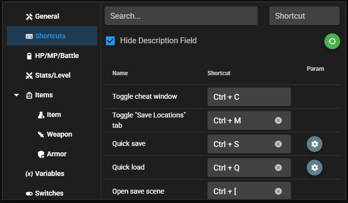

# Shortcuts

The plugin lets you bind cheat actions to keyboard shortcuts so you don't need to open the cheat window for common operations.

## Default Shortcuts

Many actions come pre-bound to convenient shortcuts. You can use these immediately without any setup.

| Action | Shortcut |
|--------|---------|
| **Toggle Cheat Window** | <kbd>Ctrl</kbd> + <kbd>C</kbd> |
| **Find a Feature** | <kbd>Ctrl</kbd> + <kbd>P</kbd> |
| **Message Log** | <kbd>Ctrl</kbd> + <kbd>H</kbd> |
| **Toggle "Save Locations" Tab** | <kbd>Ctrl</kbd> + <kbd>M</kbd> |
| **Quick Save (Slot 1)** | <kbd>Ctrl</kbd> + <kbd>S</kbd> |
| **Quick Load (Slot 1)** | <kbd>Ctrl</kbd> + <kbd>Q</kbd> |
| **Open Save Scene** | <kbd>Ctrl</kbd> + <kbd>[</kbd> |
| **Open Load Scene** | <kbd>Ctrl</kbd> + <kbd>]</kbd> |
| **Go to Title Screen** | <kbd>Ctrl</kbd> + <kbd>T</kbd> |
| **Force Victory (in Battle)** | <kbd>Ctrl</kbd> + <kbd>V</kbd> |
| **Force Defeat (in Battle)** | <kbd>Ctrl</kbd> + <kbd>D</kbd> |
| **Force Escape (in Battle)** | <kbd>Ctrl</kbd> + <kbd>E</kbd> |
| **Toggle No-Clip** | <kbd>Alt</kbd> + <kbd>W</kbd> |
| **Toggle Mouse Teleport** | <kbd>Alt</kbd> + <kbd>M</kbd> |
| **Enemy Wound (Set 1 HP)** | <kbd>Alt</kbd> + <kbd>1</kbd> |
| **Enemy Recovery** | <kbd>Alt</kbd> + <kbd>0</kbd> |
| **Party Wound (Set 1 HP)** | <kbd>Alt</kbd> + <kbd>2</kbd> |
| **Party Recovery** | <kbd>Alt</kbd> + <kbd>9</kbd> |
| **Open DevTools** | <kbd>F12</kbd> |

## Customizing Shortcuts

You can change any of these bindings or add new ones in the **Shortcuts** tab:

1. Open the cheat window (<kbd>Ctrl</kbd> + <kbd>C</kbd>).
2. Go to the **Shortcuts** tab.
3. Click the action you want to bind.
4. Press the key combination you want to use.
5. The binding is saved automatically.

## Sharing Shortcuts Across Games

Shortcut bindings are stored in `www/cheat-settings/` (MV) or `cheat-settings/` (MZ) inside the game folder. Use **Settings > Game Options > Portable Settings Backup** to transfer supported bindings without copying game-specific locks or favorites. See [Sharing Settings](/guide/features/sharing-settings).

Ctrl+P and Ctrl+H work in both window modes and prevent the browser's Print and
History commands. They do not interrupt the shortcut-recording fields. If an
existing customized shortcut already uses one of these combinations, migration
leaves the new action unassigned rather than replacing your binding.
